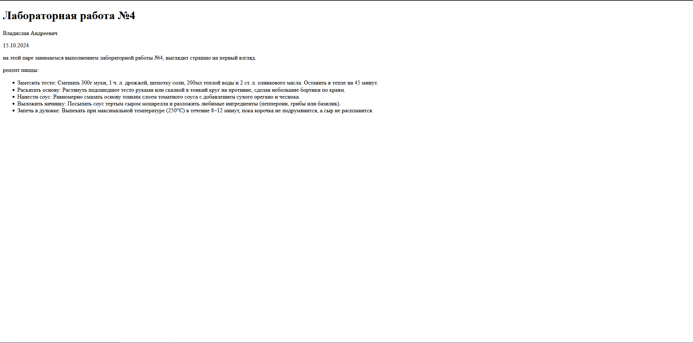
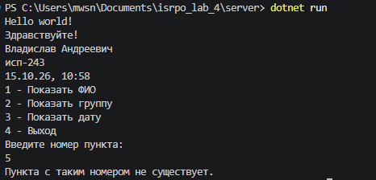
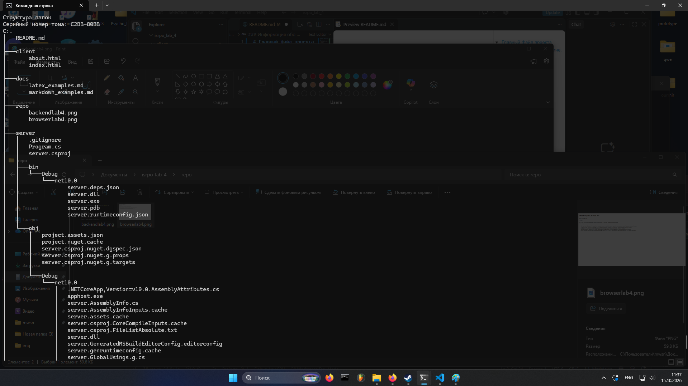

# Главный файл проекта
---
### Информация обо мне:
* Владислав Андреевич
* ИСП-243
* 15.10.26
___
### Описание проекта

* разработка приложения на c# 
* разработка двух html страниц 
* гибкая работа с git
---
### Содержание проекта
1. [Описание проекта](#описание-проекта)
2. [Структура проекта](#структура-проекта)
3. [Примеры Markdown](#примеры-markdown)
4. [Примеры LaTeX](#примеры-latex)
5. [Запуск проекта](#запуск-проекта)
6. [Ссылка на репозиторий](#ссылка-на-репозиторий)
7. [Скриншоты](#скриншоты)
8. [Заключение](#заключение)
## Структура проекта

```
isrpo_lab_4
│   README.md
│
├───client                  
│       about.html
│       index.html
│
├───docs                   
│       latex_examples.md
│       markdown_examples.md
│
├───repo                    
│       backendlab4.png
│       browserlab4.png
│       structuralab4.png
│
├───server                  
│       .gitignore
│       Program.cs
│       server.csproj
│
└───terminal_practice       
    │   data.txt
    │   logs.txt
    ├───data
    │       text.txt
    └───logs
            app.log
```

| Каталог / файл | Назначение |
|---|---|
| `client/` | HTML-страницы для браузера |
| `server/Program.cs` | серверное приложение |
| `docs/` | примеры Markdown |
| `repo/` | скриншоты по ходу лабораторной работы |
| `terminal_practice/` | файлы для упражнений с командной строкой |

### Заголовки

```
# Заголовок 1
## Заголовок 2
### Заголовок 3
```

### Списки

Маркированный список:

- пункт первый
- пункт второй
  - вложенный пункт

Нумерованный список:

1. шаг первый
2. шаг второй
3. шаг третий

### Изображение

```markdown

```

Результат:


### Код

C#:

```csharp
Console.WriteLine("Введите номер пункта: ");
int choice = int.Parse(Console.ReadLine());

switch (choice)
    {
        case 1:
            Console.WriteLine("ФИО: Владислав Андреевич");
            break;
        case 2:
            Console.WriteLine("Группа: исп-243");
            break;
        case 3:
            Console.WriteLine("Дата: 15.10 10:51");
            break;
        case 4:
            Console.WriteLine("Выход из программы.");
            break;
        default:
            Console.WriteLine("Пункта с таким номером не существует.");
            break;
    }
```

Команда `dotnet run` запускает программу.

## Примеры LaTeX

**(inline):** площадь круга вычисляется по формуле $S = \pi r^2$, где $r$ — радиус.

**(block):**

$$
x = \frac{-b \pm \sqrt{b^2 - 4ac}}{2a}
$$

## Запуск проекта

1. Установите [.NET SDK 10](https://dotnet.microsoft.com/download).
2. Перейдите в каталог `server` и запустите его:

   ```
   cd server
   dotnet run
   ```


## Ссылка на репозиторий

🔗 [https://github.com/mewmyauu/isrpo_lab_4](https://github.com/mewmyauu/isrpo_lab_4) 

## Скриншоты

### Серверная часть

Запуск сервера кода (`server`):



### Клиентская часть

Страница в браузере (`client`):


### Структура

Структура (`isrpo_lab_4`):



## Заключение

В ходе лабораторной работы №4 было создано: статические HTML-страницы и приложение на .NET 10. Полученные навыки оформления на markdown и latex пригодятся для ведения репозиториев и подготовки профессиональных README-файлов.